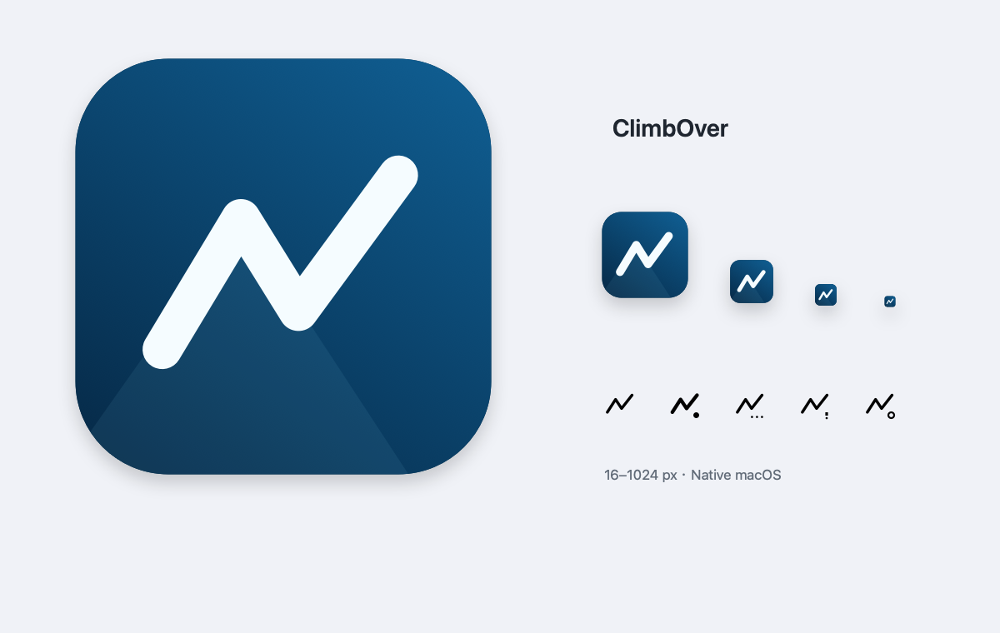

# ClimbOver

macOS 13+ 原生菜单栏代理控制器，使用 SwiftUI、AppKit、SMAppService 和 XPC。支持服务器切换、失败自动回退，以及异常退出后的 PF/DNS 恢复。

代理正常连接时，菜单栏图标右下角的圆点以约 1.8 秒为周期轻轻呼吸；停止、处理操作或异常时保持对应的静态图标。开启系统“减少动态效果”后，连接状态也使用静态图标。



## 构建准备

需要 macOS 13+、Xcode Command Line Tools，以及启用了所需功能的 `sslocal`、CoreDNS 和 `obfs-local`。仓库包含 GUI 源码、脚本、图标及配置模板；第三方可执行文件、代理服务器配置和本机网络数据由使用者准备。

脚本当前约定将本仓库放在已有代理工作目录下：

```text
workspace/
├── climboverGui/       # 本仓库
├── sslocal            # 支持 macOS PF redir 的 shadowsocks-rust
├── obfs-local         # simple-obfs 客户端
├── conf/              # redir 客户端 JSON 配置，支持子目录和 .conf/.json 扩展名
├── coredns/
│   ├── coredns        # 与 Corefile 中插件兼容的 CoreDNS 可执行文件
│   └── domains.txt    # DNS 屏蔽列表
├── direct_cidr.txt
└── lan_cidr.txt
```

`build.sh` 将三个可执行文件复制进应用包，并将 `Templates/` 中的 sslocal、CoreDNS、pf 模板及 DNS 分流数据编入二进制。CoreDNS 需要支持模板中的 blocklist、proxy、bogus 和 ipset 插件。节点配置、domains.txt 和 CIDR 数据继续从上级工作目录读取，不随源码发布；无需准备外部 Corefile。

在菜单栏面板的“更多操作”中选择“额外直连 CIDR…”，每行输入一个 IPv4 CIDR（如 `192.168.1.0/24`）。设置保存在当前用户的应用偏好中；保存后，下次启动代理或切换服务器时，会与 `direct_cidr.txt`、`lan_cidr.txt` 及代理服务器地址一起合并到 PF 的 `direct_cidr` 表。留空保存可移除额外设置。切换失败回退时使用原会话的额外 CIDR。当前 PF 规则仅处理 IPv4，编辑器不接受 IPv6。

在“更多操作”中选择“配置文件模板…”，可以编辑 sslocal JSON 和 CoreDNS Corefile，以及为 `DIRECT_DOMAINS`、`BOGUS_RESPONSES`、`APPLE_DOMAINS`、`BLOCKLIST_FILE` 分别设置 HTTP/HTTPS URL。保存时自动下载尚无缓存的地址；启动或切换时优先使用本地缓存，缓存缺失时自动下载。列表应为 UTF-8 纯文本；域名/IP 列表每行一项或以空白分隔，支持 `#` 注释。URL 留空时使用内置列表，屏蔽列表则使用项目的 `coredns/domains.txt`。独立的 Bilibili 分流列表已移除，旧模板中的 `biliroute` 行会自动清理。

每个变量的设置页面显示缓存更新时间、大小和内容预览，并提供“重新下载并刷新缓存”。缓存按变量和 URL 分别保存在当前用户的 `~/Library/Application Support/ClimbOver/TemplateCache/` 中；下载失败、HTTP 错误、编码或内容校验失败不会覆盖有效缓存。修改 URL 后不会复用旧 URL 的缓存。保存的 URL 与模板位于当前用户偏好中；单份下载最大 16 MB，传给后台的配置总大小最大 32 MB。后台不发起网络下载，GUI 将缓存内容通过经过身份校验的 XPC 请求传给后台。

`BLOCKLIST_FILE` 下载的是文件内容，后台将其写到运行目录的 `blocklist.txt`，再把该本地绝对路径替换到 Corefile。其他三个变量替换为缓存中的域名/IP 列表。保存或刷新缓存后，在下次启动代理或切换服务器时生效；切换失败会恢复旧会话的 sslocal、Corefile 和下载的屏蔽列表内容。sslocal 模板仍用于本地监听，必须保留 `redir`、`127.0.0.1:59097` 和 `tcp_only`，服务器、凭据及插件参数来自节点配置。旧版已保存模板可继续使用。


## 构建与安装

在本仓库目录执行：

```sh
bash build.sh
bash sign.sh
sudo bash install.sh
open /Applications/ClimbOver.app
```

只编译或运行单元测试不需要签名证书。启用完整的 SMAppService/XPC 功能需要有效的 Apple 代码签名身份。当前签名脚本默认使用项目作者的 Developer ID；其他开发者应设置自己的 `CLIMBOVER_TEAM_ID`，并同步调整 `sign.sh` 和 `install.sh` 中的签名身份与 Team ID 校验，再重新构建、签名和安装。不要使用 `sudo` 执行构建：允许使用后台的账号 UID 会在构建时写入程序。

首次打开后点击“启用后台服务…”，在系统设置 → 通用 → 登录项与扩展中批准 ClimbOver 后台服务。

如果当前使用命令行脚本启动了代理，先在项目根目录执行 `sudo ./stop.sh`，再点击 GUI 的启动代理。GUI 不接管或停止脚本启动的代理。

## 使用

- 点击菜单栏山脊图标，选择服务器，点击启动。首次安装/启用后台需要系统管理员批准；批准后启停、切换、状态查询和日志都通过 XPC 完成，不再弹 AppleScript 管理员密码框。
- 服务器来自上级项目的 `conf/**/*.conf`、`conf/**/*.json`。只列出兼容的 redir 客户端配置。
- 每次开始、切换或失败回退时，使用已保存模板（未自定义时使用内置默认值）重新生成 `/var/run/climbover-gui/config.json`、`Corefile` 和 `pf.conf`，不复用上次遗留文件。sslocal 合并所选节点参数，统一 TCP redir 监听 `127.0.0.1:59097`，保留链式代理与插件配置；原文件不修改。
- `sslocal`、CoreDNS 和 `obfs-local` 一起打包在 `Contents/Helpers` 中，构建时复制为真实文件，安装后的运行不依赖项目中的可执行文件或原始符号链接。`sslocal` 工作目录及子进程 `PATH` 指向包内 Helpers 目录，以便启动包内 `obfs-local`；已有配置中的旧绝对路径也自动映射到包内版本。其他自定义插件保留原路径行为。
- CoreDNS 从运行目录加载根据模板即时生成的 Corefile，仅监听 `127.0.0.1:53`；屏蔽列表通过绝对路径读取项目的 `coredns/domains.txt`。模板保留现有上游 DNS、国内域名直连、bogus 和 Apple 分流行为。`Templates/DNS/` 保存内置分流数据快照，应用内可以覆盖其中三份列表；修改内置默认值则需重新构建。子进程通过原生 `posix_spawn` 创建独立会话，不依赖终端或 `nohup`。
- 代理开启时选择其他服务器会先保存旧节点的运行配置，再连接新节点。新节点启动或连通性检查失败时自动恢复旧节点；旧节点也失败时停止代理并恢复原 DNS。原配置文件后来被修改或删除也不影响已保存的回退副本。
- 配置解析、插件路径或服务器域名解析在切换前失败时，保留旧连接。切换期间禁用再次操作；后端通过互斥锁拒绝并发命令，旧会话清理未完成时不会覆盖资源启动新节点。
- 启动和回退都检查本地 DNS，并通过所选节点的 SOCKS 通道验证 HTTPS。确认成功后才显示为已开启；回退后下拉菜单同步到实际恢复的节点。
- 网络默认选择系统默认路由对应的网络服务，也可手动选择。连接期间不能修改网络服务；后台连续两次确认默认服务已变化时，会恢复旧服务的 DNS 并停止代理，之后可以重新连接。
- 停止时恢复该网络服务原有 DNS；若运行期间已被其他软件改动 DNS，则保留对方的新设置。
- “停止并退出”先恢复网络，恢复失败时保留应用，便于重试。
- “更多 → 查看日志”通过后台读取各日志最近 100 行，无需重复授权。
- “更多 → 停用后台服务”先确认 PF/DNS 恢复后注销服务；“重新注册后台服务…”用于同版本服务修复。系统批准入口为“后台服务设置…”。
- 启停失败时显示系统错误对话框，同时在控制面板保留错误详情。
- 每个会话会启动独立的 root 监控进程，每 2 秒检查代理、CoreDNS、插件和 GUI 的存活。异常退出后自动清理本会话的 PF、进程并恢复 DNS，不需要再次授权；面板显示恢复原因和时间。
- 恢复失败时继续尝试独立的 DNS/PF 清理步骤，并保留未完成状态供后台重试。PF 规则清理或 DNS 恢复尚未确认时，保留相关代理/DNS 进程及 PF 引用，避免残留转发指向已关闭服务。正常停止后监控退出；旧会话的监控不能操作新会话。

## 实现边界

后台通过 `SMAppService.daemon` 注册，由 launchd 以 root 启动 `Contents/Helpers/ProxyControl daemon`。服务声明位于 `Contents/Library/LaunchDaemons/com.dfordsoft.climbover.daemon.plist`。GUI 通过特权 Mach XPC 连接访问，使用 `NSXPCConnection.setCodeSigningRequirement` 双向约束 Apple 签名链、Team ID 与精确的程序标识，后台额外限制为构建时的账号 UID。

后台接口只支持 start、stop、snapshot、logs、prepareUpdate。项目根目录、账号 UID 与 Team ID 固定编入二进制；XPC 不接收任意可执行路径、命令或调用者自报的进程 ID，GUI 所有者由连接元数据确认。启动配置继续限制在项目 conf 目录，网络服务按系统实际列表校验。

`build.sh` 生成的临时签名构建仅用于编译和单元测试；`sign.sh` 逐一为包内 sslocal、CoreDNS、obfs-local、后台和 GUI 使用本机 Developer ID 签名并开启 hardened runtime，当前项目 Team ID 为 Y73SBCN2CG。嵌套组件签名完成后再签外层应用包，签名未添加公证票据。首次安装必须运行 `install.sh`，应用复制到 `/Applications/ClimbOver.app` 并设为 root 所有、普通账号不可写。项目路径或使用账号改变后，需要重新构建、签名和安装。

升级：先在已安装应用中停用后台服务并退出，构建和签名新版，然后运行 `sudo bash install.sh`，再打开应用启用后台。安装脚本拒绝覆盖仍在运行的后台，旧包保留为 `/Applications/ClimbOver.previous.日期-时间.app`。卸载：先停用后台服务、退出应用，再删除应用包；不应直接删除仍被 launchd 使用的文件。

后端独立使用 `com.apple/climbovergui` PF anchor 和自己的 PF 引用令牌，不刷新主规则集、不关闭其他软件的 PF 引用。沿用现有系统中的 `com.apple/*` 通配 hooks；缺失时会提示而不重写 `/etc/pf.conf`。透明代理范围与现有脚本一致：IPv4 TCP，不提供 UDP/IPv6 全流量接管。

PF 恢复以内核回读为准：启动/回退后确认过滤规则、NAT、地址表、启用状态和本应用引用有效；停止时确认自身 anchor 的过滤规则、NAT、地址表均为空，再释放并确认自己的令牌消失。已被外部失效的令牌按已释放处理，未知输出或残留则保留恢复日志并重试。即使会话文件已不存在，停止仍会清理和确认本应用保留命名空间中的残留规则。系统及其他程序的主规则、anchor、引用由各自管理，应用不会加载全局 PF 快照覆盖它们。

`sslocal` 除透明代理端口 `127.0.0.1:59097` 外，还在 `127.0.0.1:59098` 提供内部 SOCKS 健康检查监听。该监听使用独立的强制代理 ACL，以免直连规则使不可用节点误通过检查。DNS 冷启动检查最多两次、每次最多 5 秒。HTTPS 检查依次尝试两个测试站点，每个最多 8 秒；目标站点均不可达时会视为连接失败。检查覆盖当时的可用性，不代表所有网站都可访问。

运行状态与凭据副本位于 `/var/run/climbover-gui`，凭据和日志仅 root 可读。GUI 通过经过身份校验的 XPC 读取状态和恢复记录，后台提供日志读取接口。保留公开摘要供本机诊断。进程通过 PID 和内核记录的微秒级启动时间识别，避免误认复用 PID，也能保持进程 exec 前后的身份一致。启动交接期间，子进程先等待自己的 PID 写入状态文件，再执行代理程序，防止控制进程被强制终止时留下未登记的服务。

监控独立于 GUI，GUI 被强制退出后仍可恢复。会话监控由后台额外监测，监控自身退出后后台执行恢复；后台由 launchd 维护，后台重启后先清理旧会话，不自动重连。系统登录或重启时后台可由系统启动，但代理仅在用户明确启动后连接。系统断电/内核崩溃，以及进程仍存活但内部挂死，不在当前自动恢复保证范围内。必要时重新打开应用点击停止，或在终端执行：

```sh
sudo ./build/ClimbOver.app/Contents/Helpers/ProxyControl stop
```

不要在 GUI 会话期间运行旧的 `stop.sh`：旧脚本按进程名杀进程，而且操作不同的 PF anchor。不要在 GUI 会话期间重建应用或同时手动运行旧启动脚本。CoreDNS 配置来自应用中保存的模板或内置默认模板；修改上级项目的 Corefile 不会影响 GUI 会话。

本地配置可以包含可执行插件路径，所以项目配置、二进制和应用应视为自己信任的本地文件；此版本不面向多用户不可信配置分发。

## 图标

应用图标使用深蓝底与一条越过山脊的白色路径。菜单栏复用同一矢量标记，使用系统模板图像自动适配浅色/深色外观；连接、处理中和异常状态分别使用实心点、省略点和感叹号，同时提供 VoiceOver 状态描述。

可编辑绘图源为 `Sources/ClimbOver/BrandArtwork.swift`，生成工具为 `Tools/RenderIcons.swift`。运行 `bash generate-icons.sh` 重新生成 `Assets/AppIcon.icns`、1024 px PNG 和尺寸预览；应用构建直接打包这些资源。ICNS 包含 16–1024 px 的十种标准尺寸，兼容 macOS 13+。

## 验证

```sh
bash test.sh
./build/ClimbOver.app/Contents/Helpers/ProxyControl check .. huacloud/us-adv-iepl-2.conf
```

测试覆盖模板生成、连续启动覆盖遗留配置、配置权限、DNS 路径引用、新旧格式配置归一化、链式代理保留、原配置不变、无效配置拒绝、路径和符号链接越界、命令参数引用、原生独立进程会话、工作目录和插件查找，以及通过 macOS 原生 `pfctl -n` 解析生成的 PF 规则。恢复测试覆盖进程异常、旧会话隔离、睡眠/唤醒及网络变化的判断逻辑、独立步骤失败、重试和 DNS 所有权。构建和这些测试不会修改 PF、DNS 或现有代理。

可选实机测试：先停止已有代理，再执行 `sudo bash smoke-test.sh`。它短暂启动代理，验证本地 DNS、HTTPS 请求以及停止后的原 DNS 恢复；即使测试中途失败也会尝试清理会话。

故障注入测试：`sudo bash recovery-smoke-test.sh 配置相对路径 网络服务名`。它分别强制结束代理、CoreDNS、模拟 GUI 所有者和启动中的控制进程，检查后台能否恢复 DNS、清空本应用 PF 规则并清理代理/插件。默认要求没有正在运行的会话；显式添加第三个参数 `--replace-active` 可暂时替换当前 GUI 会话，结束后恢复原节点。硬件睡眠和实际网络接口切换需要另行手动验收。

切换实机测试：停止已有代理后，执行 `sudo bash switch-smoke-test.sh huacloud/us-adv-iepl-3.conf Wi-Fi`。它以指定可用节点为基础生成临时测试配置，验证正常连续切换、无效配置、启动错误、不可达节点、运行快照回退、双重失败、并发拒绝以及原 DNS 保留。不会修改真实配置，结束后停止测试代理并移除临时文件；基础节点需使用当前项目中的 obfs-local 插件。

PF 隔离实机测试：`sudo bash pf-preservation-test.sh huacloud/us-adv-iepl-3.conf Wi-Fi`。测试期间持有独立的 PF 启用引用以及独立规则和地址表，再运行切换/回退测试。验证回退后的实际 PF 规则和直连表与旧节点一致，停止后自身规则和引用全部清理，同时主规则及独立配置保持不变；清理测试引用后检查全局启用状态和引用集合回到测试前基线。

## XPC 验证

已安装、签名并经系统批准的 GUI 可直接执行以下诊断入口（无需 sudo）：

```sh
/Applications/ClimbOver.app/Contents/MacOS/ClimbOver --service-status
/Applications/ClimbOver.app/Contents/MacOS/ClimbOver --service-smoke huacloud/us-adv-iepl-2.conf Wi-Fi
```

smoke 入口要求没有运行中的代理，会通过真实 XPC 执行启动、状态、日志和停止，结束后保持停止状态。`--service-register` 与 `--service-unregister` 分别用于诊断注册和安全注销。

单元测试额外覆盖固定操作白名单、路径边界、请求大小/NUL 校验、签名要求和不依赖 argv[0] 的后台路径定位。未签名客户端拒绝测试源码位于 `Integration/UntrustedClient/main.swift`；只能在合法签名 GUI 已确认可以正常连接后，将其拒绝结果作为有效验证。

## 许可证

Copyright (C) 2026 Fan Yang.

本项目源码和原创图标以 **GNU General Public License v3.0 only（GPL-3.0-only）** 发布，完整文本见 [LICENSE](LICENSE)。

构建时打包的 shadowsocks-rust、CoreDNS、simple-obfs 等第三方组件分别适用其自身许可证；本源码仓库不包含这些第三方二进制文件。
